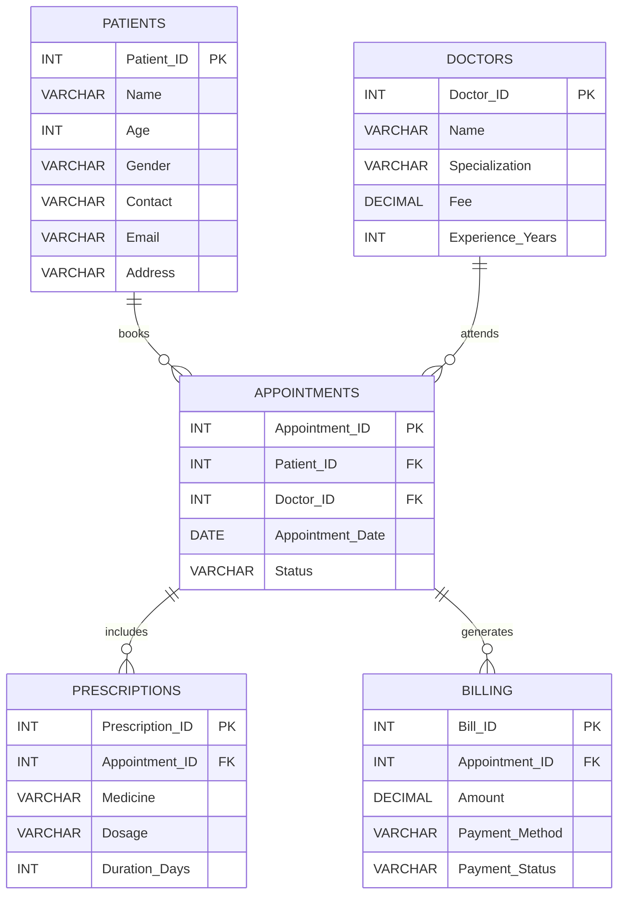

  

# MediTrack — Hospital Patient Management System

A MySQL database project that models core hospital workflows, including patient records, doctors, appointments, prescriptions, and billing. It demonstrates relational database design and SQL querying for operational reporting and basic revenue analysis.

## Project Overview

The project includes:
- Five related tables with primary and foreign keys
- Sample data for patients, doctors, appointments, prescriptions, and bills
- SQL queries using joins, aggregate functions, subqueries, sorting, grouping, and a window function
- Indexes to support common lookups
- Views for high-value bills and revenue summaries

## Entity Relationship Diagram (ERD)

The ER diagram below is embedded in this README and is rendered by GitHub. It reflects the tables and foreign-key relationships defined in `hospital_patient_management_system.sql`.

### Relationship summary

- **Patients → Appointments:** a patient can have multiple appointments; each appointment references one patient.
- **Doctors → Appointments:** a doctor can attend multiple appointments; each appointment references one doctor.
- **Appointments → Prescriptions:** an appointment can have multiple prescription entries.
- **Appointments → Billing:** an appointment can be linked to billing records. The current schema does not enforce one bill per appointment because `Billing.Appointment_ID` is not declared unique.

## Database Schema

| Table | Purpose |
|---|---|
| `Patients` | Patient contact and demographic details |
| `Doctors` | Doctor profiles, specializations, experience, and consultation fees |
| `Appointments` | Appointment date, status, and patient/doctor references |
| `Prescriptions` | Medicines prescribed for an appointment, including dosage and duration |
| `Billing` | Bill amount, payment method, and payment status |

## SQL Concepts Demonstrated

- **Filtering and sorting:** `WHERE`, `ORDER BY`, `LIMIT`
- **Joins:** combining patient, appointment, doctor, prescription, and billing data
- **Aggregations:** `COUNT()`, `SUM()`, `AVG()`, and `GROUP BY`
- **Subqueries:** comparing bills with the average amount and identifying doctors without appointments
- **Window functions:** cumulative billing revenue over appointment dates
- **Indexes:** patient appointment lookup and unique patient email index
- **Views:** `HighValueBills` and `RevenueSummary`

## Getting Started

### Requirements
- MySQL 8.0+ recommended (the script uses a window function)
- MySQL Workbench, DBeaver, or another MySQL client

### Run the project

1. Clone or download this repository.
2. Open `hospital_patient_management_system.sql` in your MySQL client.
3. Execute the script.
4. Explore the tables, analytical queries, indexes, and views.

The script creates and selects a database named `MediTrack`.

> **Note:** The script is intended as a setup-and-analysis script. Running it again against an existing database may fail because the database, tables, indexes, and views are created without drop or existence checks.

## Repository Contents

- `hospital_patient_management_system.sql` — database schema, sample data, queries, indexes, and views
- `README.md` — project overview, ER diagram, schema summary, and execution instructions

## Learning Outcomes

This project demonstrates how to structure a small relational database, connect entities through foreign keys, and answer practical hospital-management questions with SQL.

## Future Improvements

- Add constraints such as `NOT NULL`, status/payment checks, and a unique constraint on `Billing.Appointment_ID` if the intended business rule is one bill per appointment.
- Add a separate date dimension or year-month grouping for reporting across multiple years.
- Include query result screenshots and automated validation tests.

---

**Tech stack:** MySQL · SQL · Relational Database Design
